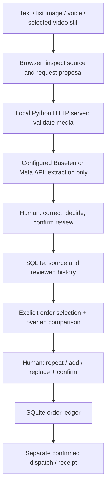

# OrderThread

A customer sends an order list to a sewing-materials seller. Later, another list arrives with some of the same items. Should the seller leave the original order alone, add more items, or replace part of the order?

OrderThread keeps the source beside the AI proposal and flags possible overlaps with an existing order. If the intent is unclear, the seller asks the customer outside OrderThread and records what they confirm. The seller can correct the proposal, save the review, and separately confirm what changes on the order.

Say the first order has **10 blue zips, 20 cm**. A follow-up lists those same **10 blue zips** alongside **two packs of white buttons**. If the customer confirms the zips are a repeat, the seller keeps the quantity at 10 and adds the buttons separately.

After confirmation, the seller can record a partial dispatch and later record receipt as a separate action. The order history keeps the reviewed sources and decisions together. Catalogue matches give the seller product references while reviewing an item.

[Open the public OrderThread demo](https://orderthread-1.onrender.com/). Use synthetic data and select **Use example** to start with a sample message. Live reviews require a slot in the shared AI allowance.

## What OrderThread can review

The hosted demo uses Meta’s **Muse Spark Open** through **Baseten** (`meta-models/muse-spark-open-1026`) to extract proposals from these inputs:

- **Text and order-list images.** Paste a message or upload a list image to propose items and quantities.
- **Voice notes.** Record or upload audio to get a transcript and proposed items or instructions, such as a pickup note.
- **Selected video frames.** Choose a still from a video and send that still for AI image review. Review any speech separately in **Voice note**.

In the local app, **CSV catalogue documents** follow a separate import workflow. Preview the rows, map the product columns, and confirm the import. Catalogue matches give the seller optional references during review. Order quantities change through order confirmation, and stock availability is outside the catalogue’s scope.

The seller checks each proposal against its source, asks the customer outside the app when intent is unclear, and explicitly confirms changes. Bring in messages or media manually from channels such as WhatsApp, Instagram or Messenger.

## Judge demonstration and evaluation

Run `python demo.py` after setup for a fresh isolated database at http://127.0.0.1:8885 with a visible **SYNTHETIC JUDGE DEMO / LIVE AI** banner. It generates two labelled list images and a pickup voice script in an ignored local session folder. It does not seed orders, overwrite existing history or mock the provider. Each launch starts a fresh session; prior demo sessions remain local. Follow [DEMO.md](DEMO.md): initial blue/red zips, separate pickup recording, repeated blue zips plus new white buttons, then dispatch four blue zips.

[The evaluation protocol](EVALUATION.md) and [eight labelled cases](evaluation_cases.json) distinguish expected behaviour from observations. `python evaluate.py offline` checks deterministic rules plus an explicitly mocked audio attachment workflow in temporary databases. `python evaluate.py template --mode live-ai` creates a blank local record for real provider rehearsal. No live outputs or accuracy scores are invented. See [VERIFICATION.md](VERIFICATION.md) for checks completed during preparation.

## Architecture



Pillow validates images; bundled FFmpeg validates/converts media and extracts selected stills locally. Provider credentials stay server-side. The normal launcher uses `OrderThread/orderthread.db`; the synthetic launcher sets a unique database path before serving requests. Evaluation runs use temporary databases; observation records stay in ignored `.evaluation-runs/`.

## Layout

Run the outer `app.py` launcher. The canonical server and browser assets are in `OrderThread/`: `app.py`, `index.html`, `recorder.js`, `video-frames.js` and `catalogue.js`. The older outer HTML page is retained locally but is not served or distributed. No files need moving or deleting.

## Setup

Requires Python 3.11 or later. From the repository root:

```sh
python -m venv .venv
# Windows PowerShell:
.venv\Scripts\Activate.ps1
# macOS/Linux: source .venv/bin/activate
python -m pip install -r OrderThread/requirements.txt
```

On a **fresh checkout only**, copy `OrderThread/.env.example` to `OrderThread/.env.local` and enter your own provider credentials locally. If `.env.local` already exists, retain it; do not copy over it. Baseten uses `BASETEN_API_KEY`; Meta uses `MODEL_API_KEY`. Select an enabled model available to your account using the corresponding model variable. Model availability and provider access must be checked with your provider. Keys stay on the server. Never paste credentials into browser source, commits or screenshots.

| Provider | Local configuration | Implemented inputs |
| --- | --- | --- |
| Baseten | `AI_PROVIDER=baseten`, `BASETEN_API_KEY`, `BASETEN_MODEL` | Text, images, separately reviewed audio |
| Meta Model API | `AI_PROVIDER=meta`, `MODEL_API_KEY`, `META_MODEL` | Text and images; audio disabled in this app |

The example's model names are defaults in this prototype, not a promise of account entitlement. Choose a model enabled for your account and required inputs; Meta names must pass the app's supported-model validation. Environment variables already set in your shell take precedence over `.env.local`. Restart after configuration changes. A “configured” indicator checks key presence only. Network failures, unavailable models and malformed/empty responses remain errors; this app has no automatic mock fallback.

Run `python check_setup.py` to check Python, installed dependencies, local FFmpeg and provider-key **presence** without printing values, opening the database or calling AI. Run `python -m pip check` to verify the installed environment. A modern browser is required; Edge/Chrome on localhost supports the demonstration recording flow subject to microphone permission. Node is needed only for JavaScript tests, and Playwright/Edge only for the older browser automation fixtures. They are not required to run the app.

A new machine needs Python 3.11+, package-install network access, a provider account/key with the selected modalities enabled, provider network access/credits, and a browser. The voice demonstration also needs a working microphone or a separately recorded synthetic script. Rehearse a real image and audio request before judging; local checks cannot establish live model availability.

```sh
python app.py
```

Open http://127.0.0.1:8765. Stop an existing server with Ctrl+C before restarting; a second listener on the same port is rejected. A fresh checkout creates its own local SQLite database in `OrderThread/`. Do not overwrite an existing database or `.env.local` when updating an installation.

## Audio and review

In the local app, uploads and in-app recordings are limited to 60 seconds and 5 MiB. The server validates content, format and duration. WAV follows the existing direct path; supported phone formats use FFmpeg supplied by `imageio-ffmpeg`. The dependency must provide an executable supported on your machine; unreadable files or failed conversion produce an error. Renaming an extension does not convert a recording. Browser recording requires microphone permission and a secure context: localhost for development, HTTPS for deployment on phones. File upload remains available when recording is unsupported.

Transcripts are AI-generated and audio remains identified as the source. Instruction-only notes can be reviewed and attached to an explicitly selected order without inventing items or requiring quantities. Nothing changes automatically.

## Video frame review

In the local app, choose **Video frame review** to upload MP4, MOV or WebM video up to 60 seconds, 20 MiB and 4K. H.264 MP4 gives the broadest browser playback support. H.264/H.265, VP8/VP9 and AV1 tracks are validated locally through the existing `imageio-ffmpeg` dependency. No additional hosted video service is used.

Play, pause or seek, then explicitly select up to three stills. Review each still independently through the existing image extraction and confirmation flow. Only the chosen still is sent to AI: events between frames can be missed, and the audio track is not analysed. Playback positions are approximate selection references, not verified event timestamps or quotes. Repeated products across frames require separate human decisions and the existing order overlap checks.

Before confirmation, video/frame drafts stay in bounded server memory for up to 30 minutes (temporary decoding files are removed). Saving a reviewed frame also saves the original video in a separate additive `source_videos` table and retains its relationship in review, application and attachment history. Refresh preserves confirmed source associations; unsaved frame selections are intentionally cleared. Discarding a draft does not delete confirmed history. Original video files and local database files are excluded from Git.

Supply speech as a separate recording or audio file in Voice note mode. Review its AI-generated transcript and instructions independently, then explicitly attach the reviewed source to the selected order. Nothing automatically merges the inputs or changes quantities.

Video file reads have a 15-second deadline, validation/frame requests a 40-second deadline, and local decoding a 30-second process deadline. Draft cleanup runs independently so a failed cleanup cannot block a new upload. A timeout displays an actionable error and releases the controls.

Run focused tests with `python -m unittest -q test_video_frames.VideoFrameTests` and `node video_frames_test.cjs`. The browser fixture is `python browser_video_server.py` on port 8884; it prints a temporary synthetic-media folder and uses a temporary database with mocked image/audio responses. Stop it with Ctrl+C. It never calls a real provider.

## Catalogue

Use the catalogue panel to upload a UTF-8 CSV, preview and map product name, variant and unit columns, then explicitly confirm the import. `OrderThread/sample-catalogue.csv` contains synthetic products only. Missing names and duplicate rows are rejected. Catalogue matching offers optional references during item review; it does not change quantities or imply stock availability. Limits: 256 KiB, 1,000 rows and 30 columns per import; 10,000 catalogue products. Search returns at most 200 products and review suggestions show at most five matches.

## Tests

API tests use temporary databases and mocked AI responses. Mobile audio tests generate synthetic audio and exercise real local FFmpeg conversion. Run:

```sh
python -m unittest -q test_app test_audio test_mobile_audio test_attachments test_overlaps test_startup test_catalogue test_video_frames
node recorder_test.cjs
node video_frames_test.cjs
```

The documented command includes inherited repeated tests. New demo safety checks run with `python -m unittest -q test_demo`; labelled offline evaluations run with `python evaluate.py offline`. Browser scripts require Node.js, Playwright and an installed Microsoft Edge browser. Install Playwright in a separate local tooling environment (excluded from Git), or set `PLAYWRIGHT_MODULE` to its module path. Start the corresponding `browser_*_server.py` fixture before running its browser test. Fixtures use temporary databases and synthetic/mocked data on ports 8876 through 8883; they must not be pointed at the production database. `browser_recorder_test.cjs` uses the audio fixture on 8878 and a simulated microphone.

Previously verified browser flows include review, attachments, overlap decisions, recording and catalogue import. These browser tests use simulated inputs. A hosted live voice-note review was reported successful separately. The microphone path on a specific device depends on browser support and permissions.

## Data and deployment

This repository includes application code, synthetic catalogue data and tests, not customer orders, uploads, recordings, credentials, database files, logs or local investigation notes. Keep private backups separately. The local development server has no user authentication and is intended for a trusted local machine. Deploying it requires an appropriate authenticated hosting setup, HTTPS, protected credentials and a data backup policy.

## Hosted synthetic demo

Hosted text, image, voice-note and selected video-frame reviews were tested with live Baseten requests. The hosted video upload limit is **10 seconds and 1 MiB** for MP4, MOV or WebM. The public server caps request bodies and outgoing AI payloads at **2 MiB**, including JSON and base64 encoding, so hosted image and audio files may need to be smaller than the local limits.

Each browser gets a temporary workspace. The service supports up to **16 workspaces per process**, and clears inactive workspaces after **30 minutes** when processing a subsequent workspace request. Orders and uploads can also disappear on restart, redeployment or Render Free spin-down.

The AI allowance is shared across visitors. Cloudflare D1 reserves one attempt before each Baseten call. When the allowance is exhausted or D1 is unavailable, the app stops before calling Baseten. Failed requests and timeouts can consume a slot. Applying a saved review uses no further AI attempt. Baseten credit coverage and actual charges remain unconfirmed.

### Deploy the hosted demo

- Use a Render **Docker** web service with `./Dockerfile.public` from the repository root. Set `DEMO_ORIGIN` to the service’s HTTPS origin without a trailing slash. The server uses the host’s `PORT` and exposes `/healthz`.
- Initialize a dedicated Cloudflare D1 database with [public_ai_budget.sql](public_ai_budget.sql). It starts with zero attempts. Set `D1_ACCOUNT_ID`, `D1_DATABASE_ID` and `D1_API_TOKEN` privately in the host environment. The token needs D1 write access to reserve attempts.
- Set `BASETEN_MODEL` to `meta-models/muse-spark-open-1026` and set `BASETEN_API_KEY` privately in the host environment. Verify that a review is blocked at zero allowance before opening a limited judging allowance.
- Use the standard `./Dockerfile` for the separate password-protected fixture service. Set its own `DEMO_ORIGIN` and a `DEMO_PASSWORD` of at least 24 characters. Sign in as `judge`. It uses fixed synthetic examples and needs no provider credentials.

## Submission

Keep credentials, databases, customer data and recordings outside the repository. The source repository, hosted demo and demo video are separate submission links.

## Current limitations

- AI extraction/transcription can miss products, variants or quantities. Human corrections and explicit confirmations are required; saved reviews are not proof the AI was accurate.
- Overlap detection uses product/variant normalization and conservative matching, not semantic proof of intent. It can miss overlaps or warn incorrectly. Missing variants may warn conservatively; record both errors in evaluation.
- Quantities are positive whole numbers. Units are represented in item/variant text and optional catalogue references; there is no inventory, payment, customer messaging or automatic order association.
- Replacement is blocked once a line has dispatch/receipt history. Dispatch and receipt are independently confirmed; dispatch does not imply receipt.
- Selected-frame video review is image extraction only, with no synchronized audiovisual understanding. Unselected events may be missed; playback positions are approximate references.
- Drafts expire after 30 minutes or a restart; refresh clears unsaved selections. Confirmed history persists in the selected local SQLite database. The public demo keeps separate temporary workspaces through browser cookies.
